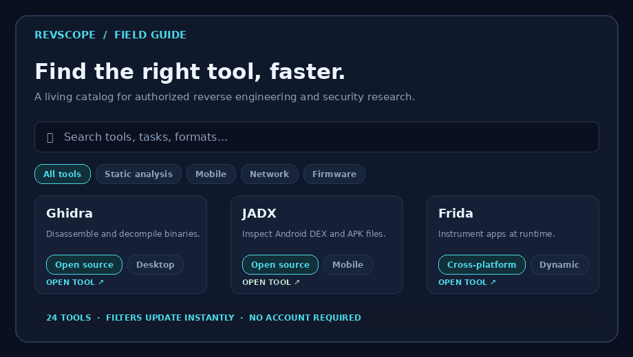
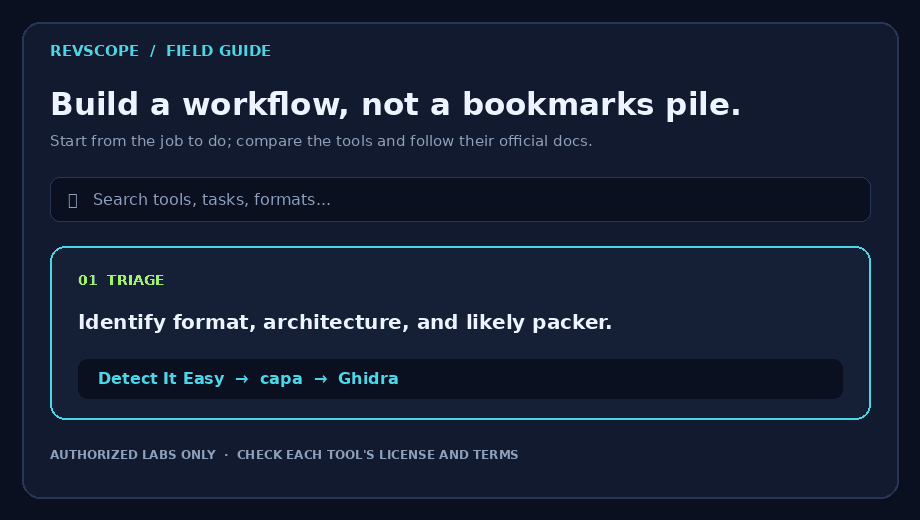

<div align="center">

# RevScope

### Reverse Engineering Field Guide

**Find the tool. Understand the workflow. Do the analysis responsibly.**

[](https://brunnojob.github.io/revscope/)
[](https://github.com/brunnojob/revscope/issues?q=is%3Aissue+is%3Aopen+label%3A%22good+first+issue%22)
[](LICENSE)
[](https://github.com/brunnojob/revscope/stargazers)

**A searchable, community-curated map of reverse engineering tools and practical starting points.** Browse by task, platform, license, or learning curve. Compare options. Follow links to the people who build and document each tool.

</div>

---

## See RevScope in action

### Explore and filter the catalog



### Start from a workflow



> **Try it now:** [Open the live catalog](https://brunnojob.github.io/revscope/) · [Browse open issues](https://github.com/brunnojob/revscope/issues)

## Why RevScope?

Tool lists are useful until you need to choose. RevScope adds the context that makes a list actionable:

- **Search and filter:** find tools by category, platform, learning curve, and tags.
- **Workflow shortcuts:** get a focused starting set for binary triage, Android, network behavior, or firmware.
- **Compare:** line up up to three tools by purpose, platform, license, and cost.
- **Save locally:** keep a personal shortlist in your browser; nothing is sent to a server.
- **Go to the source:** each entry points to an official project page and documentation.
- **Contribute clearly:** proposals include the task, platform, license, and authoritative links.

No account, backend, analytics, or sample uploads. The catalog is static and runs in your browser.

## Quick start

Open the [live catalog](https://brunnojob.github.io/revscope/) or run the files locally from a small static server:

```bash
python -m http.server 8000
```

Then visit `http://localhost:8000`. The page loads its catalog from `data/tools.json`.

## What's inside

| Area | Starting points |
| --- | --- |
| Triage & identification | Detect It Easy, capa, FLOSS |
| Disassembly & decompilation | Ghidra, IDA Free, Cutter, radare2 |
| Android & mobile | JADX, Apktool, MobSF, Frida |
| .NET & managed code | ILSpy, dnSpyEx |
| Network & protocols | Wireshark, mitmproxy, Burp Suite Community |
| Firmware & embedded | Binwalk, OpenOCD |
| Emulation & lab | QEMU |

This is a starting set, not a ranking or an endorsement. Pricing, supported formats, and license terms can change; confirm details with each maintainer before adopting a tool.

## Responsible use

RevScope is for education, interoperability, debugging, preservation, and security research conducted with permission. Analyze only software, devices, and traffic you own or are explicitly authorized to assess. Follow applicable law, vendor terms, and each tool's license. Do not use this guide to facilitate unauthorized access, evasion, theft, or harm. See [SECURITY.md](SECURITY.md).

## Help shape the catalog

New here? Pick an issue labeled **good first issue**. A useful tool proposal should include:

1. The task it helps with and a short, neutral description.
2. Supported platforms and the current license or pricing model, with a source.
3. Official project and documentation links.
4. Any caveat that affects a beginner's choice.

Read [CONTRIBUTING.md](CONTRIBUTING.md), then [open an issue](https://github.com/brunnojob/revscope/issues/new/choose) or submit a pull request.

<div align="center">

**Know a better starting point?** [Suggest a tool](https://github.com/brunnojob/revscope/issues/new/choose) · [Request a workflow](https://github.com/brunnojob/revscope/issues/new/choose) · [Star the guide](https://github.com/brunnojob/revscope)

*Open knowledge for better analysis.*

</div>
